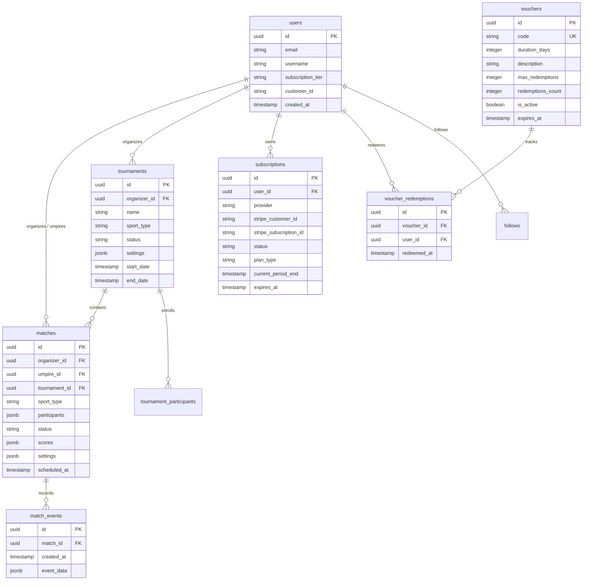

# Database Architecture & Core Schema

ScoreBoard uses PostgreSQL 15 hosted on Supabase, featuring Row Level Security (RLS), Realtime replication, and custom RPC functions.

---

## 1. Entity-Relationship Diagram (ERD)

---

## 2. Table Catalog

### `users`
- **`id`** (`uuid`, PK): References `auth.users(id)`.
- **`subscription_tier`** (`text`): `'free'` ou `'pro'`. Updated automatically via Stripe webhooks, vouchers, or manual backfills.
- **`customer_id`** (`text`): Stripe Customer ID (`cus_...`).

### `subscriptions`
Tracks active billing cycles and pass entitlements:
- **`provider`** (`text`): `'stripe'`, `'apple_iap'`, `'google_play'`, `'voucher'`, or `'manual'`.
- **`status`** (`text`): `'active'`, `'trialing'`, `'past_due'`, `'canceled'`, or `'expired'`.
- **`plan_type`** (`text`): `'monthly'`, `'annual'`, or `'lifetime'`.
- **`current_period_end`** / **`expires_at`** (`timestamptz`): Expiration timestamp for temporary vouchers or billing cycles.

### `vouchers` & `voucher_redemptions`
Powers the **Club Beta Voucher Engine**:
- **`code`** (`text`, Unique): Case-insensitive promo code (e.g., `BETA-CLUB-60D`, `PADEL-VIP-90D`, `APP-STORE-REVIEW-PASS`).
- **`duration_days`** (`integer`): Number of Pro days granted.
- **`max_redemptions`** (`integer`): Limit of allowed claims (NULL for unlimited).
- **`redemptions_count`** (`integer`): Incremented atomically upon redemption.

### `matches`
Stores individual and tournament matches:
- **`sport_type`** (`text`): `'Tennis'`, `'Padel'`, `'Volleyball'`, `'Beach Volleyball'`, `'Basketball'`, or `'Football'`.
- **`participants`** (`jsonb`): Array of participant objects `[{"name": "Player 1"}, {"name": "Player 2"}]`.
- **`status`** (`text`): `'scheduled'`, `'ongoing'`, `'completed'`, or `'cancelled'`.
- **`scores`** (`jsonb`): Live sport-specific score payload (sets, games, points, tiebreak flags, serving index).

---

## 3. Custom Database RPC Functions

| RPC Function | Parameters | Returns | Description |
| :--- | :--- | :--- | :--- |
| **`redeem_voucher`** | `code text` | `jsonb` | Atomically validates voucher status, expiration, and usage limits; inserts redemption; creates an active subscription; and elevates user to Pro. |
| **`get_my_subscription`** | *(none, uses `auth.uid()`)* | `jsonb` | Returns active subscription details, source provider, plan type, and days remaining. |
| **`appoint_match_umpire`** | `p_match_id uuid`, `p_umpire_id uuid` | `void` | Assigns an official referee or allows umpires to self-claim matches. |
