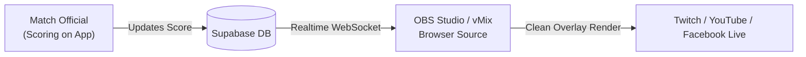

# Web Application Architecture (`scoreboard-web`)

The web frontend is built using **Next.js 16 (App Router)** with TypeScript, Tailwind CSS v4, and Supabase SSR.

---

## 1. Route Map

| Route | Type | Description |
| :--- | :--- | :--- |
| **`/`** | Client Page | Public feed, ongoing matches, active tournaments, favorites tab. |
| **`/match/[matchId]`** | Server Page + Client Wrapper | Match details, head-to-head stats, atmosphere backgrounds, options menu. |
| **`/match/[matchId]/scoreboard`** | Client Page | Official umpire scoring interface with sport-specific touch controls. |
| **`/match/[matchId]/overlay`** | Server Page + Client Component | 100% transparent live scoreboard overlay for OBS Studio and vMix broadcasts. |
| **`/my-tournaments`** | Client Page | Organizer tournament management (creation intercepted by Pro paywall for free users). |
| **`/settings`** | Client Page | User profile, active subscription status, Stripe Customer Portal link, voucher redemption, GDPR account erasure. |
| **`/terms`** | Client Page | Bilingual (EN/PT) terms of service, subscription policies, and data disclaimers. |

---

## 2. OBS & vMix Broadcast Overlay (`/match/[matchId]/overlay`)

Designed specifically as an ultra-lightweight, transparent browser source for live streaming software:

### Key Technical Characteristics:
- **100% Transparent Canvas**: Uses `fixed inset-0 bg-transparent` with no scrollbars (`overflow-hidden`).
- **Zero Hydration Mismatch**: Uses a Server Component shell (`page.tsx`) wrapping a client component (`MatchOverlayClient.tsx`) with mounted state checks.
- **Dynamic URL Parameters**:
  - `?pos=top` ou `?pos=bottom`: Screen positioning.
  - `?scale=sm`, `?scale=md`, ou `?scale=lg`: Scoreboard sizing.
  - `?brand=1` ou `?brand=0`: Optional ScoreBoard watermarking.

---

## 3. Pro Subscription & Monetization UI

- **[`UpgradeModal.tsx`](file:///Users/goncaloforte/Sandbox/ScoreBoard/scoreboard-web/components/subscription/UpgradeModal.tsx)**:
  - Toggle between **Monthly (€3.99/mo)** and **Annual (€34.99/yr, -27%)**.
  - Direct integration with Stripe Checkout (`create-checkout-session`).
  - Embedded **Club Beta Voucher** redemption field.
  - Displays `"Subscrição Pro Ativa"` state for subscribed users.
- **Top Navigation (`TopNavBar.tsx`)**:
  - Displays a clean `[🟢 PRO]` badge next to username for Pro users.
  - Automatically hidden on broadcast overlay routes (`/overlay`).
