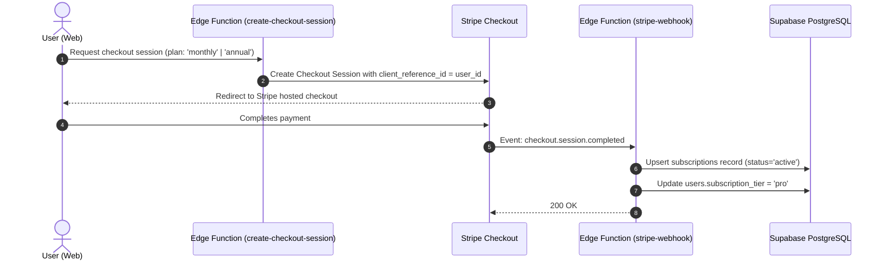

# Backend Services & Edge Functions

ScoreBoard backend services run on Supabase (PostgreSQL 15, Deno Edge Functions, and Realtime WebSockets).

---

## 1. Stripe Subscription Lifecycle

---

## 2. Edge Function Catalog

All functions are located under [`scoreboard-backend/supabase/functions/`](file:///Users/goncaloforte/Sandbox/ScoreBoard/scoreboard-backend/supabase/functions/):

### `stripe-webhook`
Handles asynchronous payment lifecycle webhooks from Stripe:
- **`checkout.session.completed`**: Creates an active record in `subscriptions` and sets `users.subscription_tier = 'pro'`.
- **`customer.subscription.updated`**: Syncs status transitions (`active`, `past_due`, `canceled`) and renewal dates.
- **`customer.subscription.deleted`**: Downgrades `users.subscription_tier = 'free'` and marks the subscription as `canceled`.
- **`invoice.payment_succeeded`** / **`invoice.payment_failed`**: Updates billing health and logs renewal confirmations.

### `create-checkout-session`
- Receives: `{ priceId?: string, planType: 'monthly' | 'annual' }`.
- Injects user ID into `client_reference_id` and metadata.
- Returns: `{ url: string }` redirecting the client to Stripe Checkout.

### `create-portal-session`
- Authenticates the current user session.
- Retrieves or generates the Stripe Customer ID.
- Returns: `{ url: string }` directing the user to the self-service Stripe Customer Portal.

### `fcm-push`
- Sends push notifications to iOS and Android devices via Firebase Cloud Messaging HTTP v1 API when followed matches score or conclude.

---

## 3. Realtime WebSockets

ScoreBoard broadcasts live game updates through Supabase Realtime:
- **Channel**: `broadcast_overlay_{matchId}` / `match-{matchId}`
- **Events**: `postgres_changes` on the `matches` table (filtered by `id = matchId`).
- **Consumers**: Web Match Details, Scoreboard Umpire screen, Mobile Spectator screen, and OBS Broadcast Overlays.
