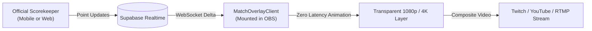

# OBS & vMix Broadcast Overlays

ScoreBoard provides a dedicated broadcast overlay route at `/match/[matchId]/overlay` specifically architected for live streaming software (OBS Studio, vMix, Wirecast, Streamlabs).

---

## 1. Streaming Architecture



---

## 2. Technical Characteristics

- **100% Transparent Background**: Root canvas uses `bg-transparent overflow-hidden fixed inset-0 pointer-events-none`.
- **Zero Hydration Mismatch**:
  - `app/match/[matchId]/overlay/page.tsx` is an async Server Component that fetches initial match metadata.
  - `MatchOverlayClient.tsx` is wrapped with a client-side mount check (`hasMounted`) to eliminate server-client mismatch errors in Chromium-based browser docks.
- **Independent Layout Guard**: The global `TopNavBar` and footer components detect overlay routes and automatically suppress themselves to maintain a clean broadcast feed.

---

## 3. Dynamic Customization Query Parameters

Streamers and tournament organizers can customize the overlay appearance directly via URL query parameters in OBS:

| Query Parameter | Allowed Values | Default | Effect |
| :--- | :--- | :--- | :--- |
| **`pos`** | `top`, `bottom` | `top` | Aligns scoreboard to top-center or bottom-center of the screen. |
| **`scale`** | `sm`, `md`, `lg` | `md` | Adjusts scale of the scoreboard widget (useful for 720p, 1080p, or 4K streams). |
| **`theme`** | `dark`, `glass`, `contrast` | `glass` | Visual style and backdrop blur level. |
| **`brand`** | `0`, `1` | `1` | Shows or hides the subtle ScoreBoard broadcast watermark. |
| **`sponsor`** | `string` (URL or text) | `null` | Displays tournament sponsor logo or banner next to the scoreboard. |

Example OBS Browser Source URL:
```text
https://scoreboard.app/match/550e8400-e29b-41d4-a716-446655440000/overlay?pos=top&scale=md&theme=dark
```
