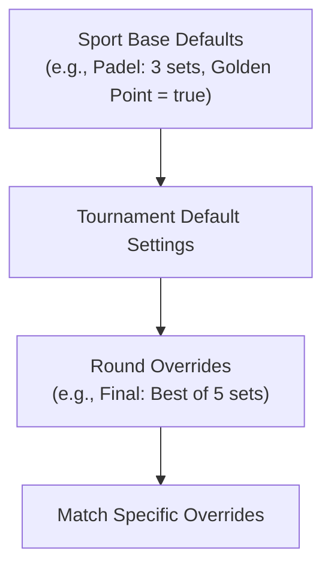

# Sports Scoring Engines & Rules Hierarchy

ScoreBoard includes dedicated scoring engines tailored to official international federations (FIP/WPT, ITF/ATP, FIVB, FIBA, FIFA).

---

## 1. Rules Resolution Hierarchy

Settings resolve dynamically at match creation and during live scoring:

---

## 2. Sport Rules Specifications

### Tennis & Padel
- **Points Progression**: `0`, `15`, `30`, `40`, `AD` (or `Game`).
- **Golden Point (*Punto de Oro*)**:
  - Standard in Premier Padel / FIP: At 40-40 (Deuce), the receiving pair chooses the serving side, and the next point immediately decides the game (no Advantage).
- **Tiebreak**:
  - Regular tiebreak at 6-6 in games: First to 7 points with a 2-point margin.
  - Super/Match Tiebreak: First to 10 points with a 2-point margin (often replacing the deciding 3rd set).
- **Service & Sides**:
  - Alternates every game; in tiebreaks, server changes after the 1st point and then every 2 points.
  - Court change (*Troca de Campo*) occurs on odd game totals (1, 3, 5...) and every 6 points in tiebreaks.

### Volleyball & Beach Volleyball
- **Indoor Volleyball**:
  - Best of 5 sets. Sets 1-4 played to 25 points (win by 2, no cap).
  - Deciding 5th set played to 15 points (win by 2).
- **Beach Volleyball**:
  - Best of 3 sets. Sets 1-2 played to 21 points (win by 2).
  - Deciding 3rd set played to 15 points (win by 2).
- **Service Rotation**: Tracks `serving_team` and awards point + service upon sideout.

### Basketball
- **Periods**: 4 Quarters of 10 minutes (FIBA standard) or 12 minutes (NBA).
- **Overtime**: 5-minute overtime periods until a winner is determined.
- **Scoring**: 1 pt (Free Throw), 2 pts (Field Goal), 3 pts (Three-pointer).
- **Fouls**: Individual foul tracking (bonus free throws upon team foul threshold).

### Football (Soccer)
- **Time Structure**: Two 45-minute halves with stoppage time.
- **Knockout Match Logic**: Extra time (two 15-minute halves) followed by a penalty shootout if tied.
- **Events**: Goals, yellow/red cards, substitutions, and VAR reviews recorded in `match_events`.
