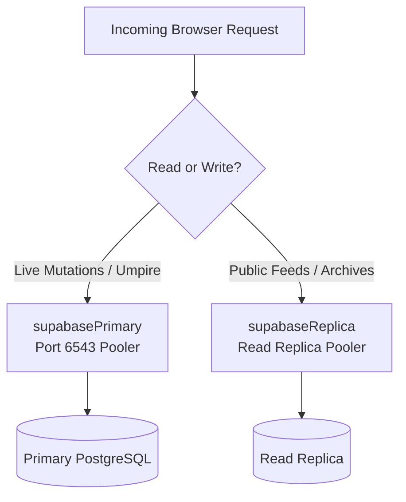

# Backend Integration & Data Contracts

This document outlines how `scoreboard-web` interfaces with Supabase services, Realtime channels, and payment APIs.

---

## 1. Supabase Client Strategy

The web application uses `@supabase/ssr` for authenticated cookie sessions and provides high-concurrency client routing via `server-scalable.ts`:

- **`supabasePrimary`**: Connects to the Primary Supavisor pooler (Port 6543, Transaction Mode) for live officiating mutations, atomic scoring RPCs, and authenticated state updates.
- **`supabaseReplica`**: Connects to Read Replicas (or falls back to Primary) with `NEXT_PUBLIC_ANON_KEY` for read-heavy public feeds, completed tournament brackets, archives, and search.
- **`getScalableClient(intent)`**: Dynamic selector helper.



---

## 2. Realtime Subscriptions

Live scoreboards and stream overlays subscribe directly to Postgres CDC events on the `matches` table:

```typescript
const channel = supabase
  .channel(`match-${matchId}`)
  .on(
    'postgres_changes',
    {
      event: 'UPDATE',
      schema: 'public',
      table: 'matches',
      filter: `id=eq.${matchId}`,
    },
    (payload) => {
      updateLocalScore(payload.new.scores);
    }
  )
  .subscribe();
```

---

## 3. Stripe Checkout & Customer Portal

Client billing interactions invoke Supabase Edge Functions:

- **`create-checkout-session`**: Triggered from `UpgradeModal.tsx`. Redirects the user to Stripe Checkout with `client_reference_id` set to the logged-in user ID.
- **`create-portal-session`**: Triggered from `settings/page.tsx`. Redirects subscribed Pro users to the Stripe Customer Portal for billing management or cancellation.

---

## 4. Consumed Database Contracts

### Matches Schema Contract
```typescript
interface MatchContract {
  id: string;
  organizer_id: string;
  umpire_id: string | null;
  tournament_id: string | null;
  sport_type: 'Tennis' | 'Padel' | 'Volleyball' | 'Beach Volleyball' | 'Basketball' | 'Football';
  participants: Array<{ name: string; seed?: number }>;
  status: 'scheduled' | 'ongoing' | 'completed' | 'cancelled';
  scores: Record<string, any>;
  settings: Record<string, any>;
  scheduled_at: string;
}
```
