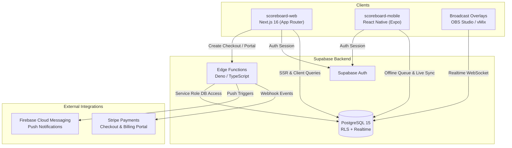

# ScoreBoard — Codebase Architecture & Living Wiki

Welcome to the technical knowledge base for **ScoreBoard**, a multi-sport live scoring, tournament management, and broadcast platform.



---

## 📚 Living Wiki Index

| Document | Topic | Description |
| :--- | :--- | :--- |
| **[`00-core-schema.md`](file:///Users/goncaloforte/Sandbox/ScoreBoard/docs/00-core-schema.md)** | **Database & Data Layer** | PostgreSQL schema, tables (`users`, `matches`, `tournaments`, `subscriptions`, `vouchers`), RLS policies, custom RPCs, and Mermaid ERD. |
| **[`01-backend-supabase.md`](file:///Users/goncaloforte/Sandbox/ScoreBoard/docs/01-backend-supabase.md)** | **Backend & Edge Functions** | Edge functions (`stripe-webhook`, `create-checkout-session`, `create-portal-session`, `fcm-push`), Supabase Realtime channels. |
| **[`02-frontend-mobile.md`](file:///Users/goncaloforte/Sandbox/ScoreBoard/docs/02-frontend-mobile.md)** | **Mobile Application** | Expo / React Native architecture, offline-first scoring queue, match umpire controls. |
| **[`03-frontend-web.md`](file:///Users/goncaloforte/Sandbox/ScoreBoard/docs/03-frontend-web.md)** | **Web Application** | Next.js 16 App Router, Match Details, live scoreboards, OBS/vMix broadcast overlays, Pro billing modal. |
| **[`04-sports-engine.md`](file:///Users/goncaloforte/Sandbox/ScoreBoard/docs/04-sports-engine.md)** | **Sports & Scoring Logic** | Rules hierarchy, set structures, tiebreak engines, Golden Points (Tennis, Padel, Volleyball, Basketball, Football). |
| **[`TERMS_AND_CONDITIONS.md`](file:///Users/goncaloforte/Sandbox/ScoreBoard/docs/TERMS_AND_CONDITIONS.md)** | **Terms & GDPR Compliance** | Subscriptions (€3.99/mo, €34.99/yr), voucher redemption, GDPR Article 17 (Right to Erasure), user data responsibility. |

---

## 🛠️ Monorepo Structure

```text
ScoreBoard/
├── docs/                        # Living technical wiki
├── scoreboard-backend/          # Supabase configuration, migrations, edge functions
│   └── supabase/
│       ├── functions/           # Deno Edge Functions (stripe-webhook, checkout, etc.)
│       └── migrations/          # Version-controlled SQL migrations
├── scoreboard-web/              # Next.js 16 Web application
│   ├── app/                     # App Router pages (matches, tournaments, overlays, settings)
│   ├── components/              # Shared UI & business components
│   └── lib/                     # Scoring rules, offline sync, i18n
├── scoreboard-mobile/           # Expo / React Native mobile app
└── .agents/                     # AI Agent configuration
    ├── rules/                   # Continuous rules (docs-sync.md)
    └── skills/                  # Open Agent Skills (living-docs, security-audit)
```
