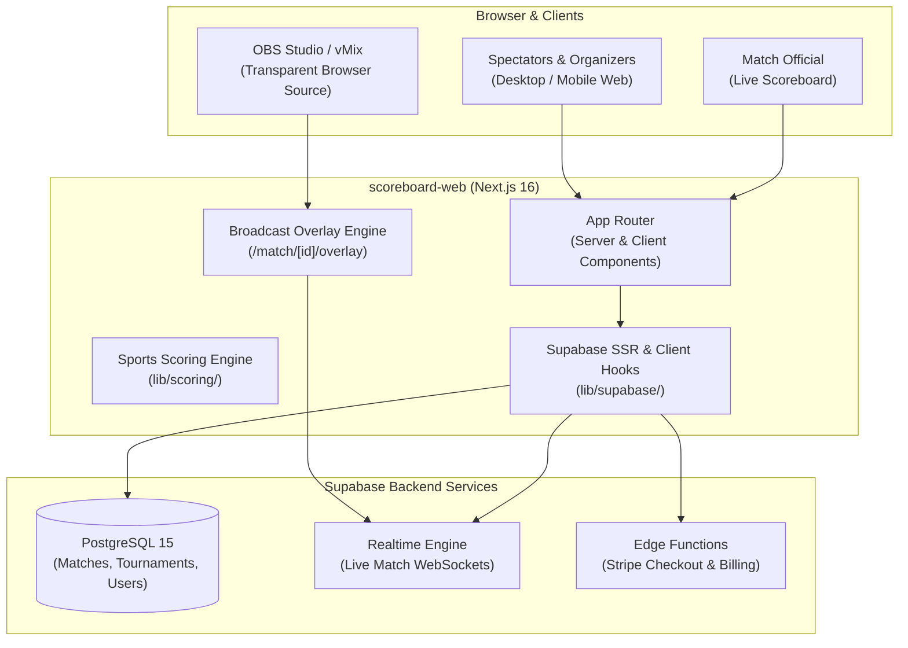

# ScoreBoard Web — Technical Wiki & Frontend Architecture

Welcome to the technical knowledge base for **`scoreboard-web`**, the web application and live broadcast overlay platform for ScoreBoard. Built with **Next.js 16 (App Router)**, React 19, Tailwind CSS v4, and Supabase SSR.



---

## 📚 Web Wiki Index

| Document | Topic | Description |
| :--- | :--- | :--- |
| **[`01-architecture-web.md`](file:///Users/goncaloforte/Sandbox/ScoreBoard/scoreboard-web/docs/01-architecture-web.md)** | **Next.js 16 App Router** | Route catalog, server vs client component isolation, navigation, and Tailwind CSS v4 styling. |
| **[`02-broadcast-overlays.md`](file:///Users/goncaloforte/Sandbox/ScoreBoard/scoreboard-web/docs/02-broadcast-overlays.md)** | **OBS & vMix Streaming Overlays** | Transparent broadcast overlays (`/match/[id]/overlay`), URL query customization, hydration safety, and Realtime sync. |
| **[`03-sports-engine.md`](file:///Users/goncaloforte/Sandbox/ScoreBoard/scoreboard-web/docs/03-sports-engine.md)** | **Frontend Scoring Engine** | Rules resolution, score calculations, tiebreaks, Golden Points for Tennis, Padel, Volleyball, Basketball, Football. |
| **[`04-backend-integration.md`](file:///Users/goncaloforte/Sandbox/ScoreBoard/scoreboard-web/docs/04-backend-integration.md)** | **Supabase & Billing Contracts** | SSR cookies, client subscriptions, Realtime channel patterns, Stripe checkout, and voucher redemption. |
| **[`TERMS_AND_CONDITIONS.md`](file:///Users/goncaloforte/Sandbox/ScoreBoard/scoreboard-web/docs/TERMS_AND_CONDITIONS.md)** | **Terms of Service & GDPR** | End-user terms, pricing tiers (€3.99/mo, €34.99/yr), and GDPR user rights rendered on `/terms`. |

---

## 🛠️ Repository Layout

```text
scoreboard-web/
├── app/                         # Next.js 16 App Router pages
│   ├── layout.tsx               # Root layout (Google Material Symbols, Fonts, TopNav)
│   ├── page.tsx                 # Home / matches / tournaments feed
│   ├── match/[matchId]/         # Match details, scoreboard, and OBS overlay
│   ├── my-tournaments/          # Tournament creator & manager
│   ├── settings/                # Profile, Stripe portal, voucher redemption
│   └── terms/                   # Terms & Conditions bilingual viewer
├── components/                  # UI components (match, tournament, overlay, subscription)
├── lib/                         # Scoring engines, Supabase clients, i18n
├── public/                      # Static assets, logos, fonts
├── tests/                       # Playwright E2E and Vitest unit tests
└── .agents/                     # AI Agent configuration
    ├── rules/docs-sync.md       # Web documentation synchronization rule
    └── skills/living-docs/      # Living Docs skill
```
